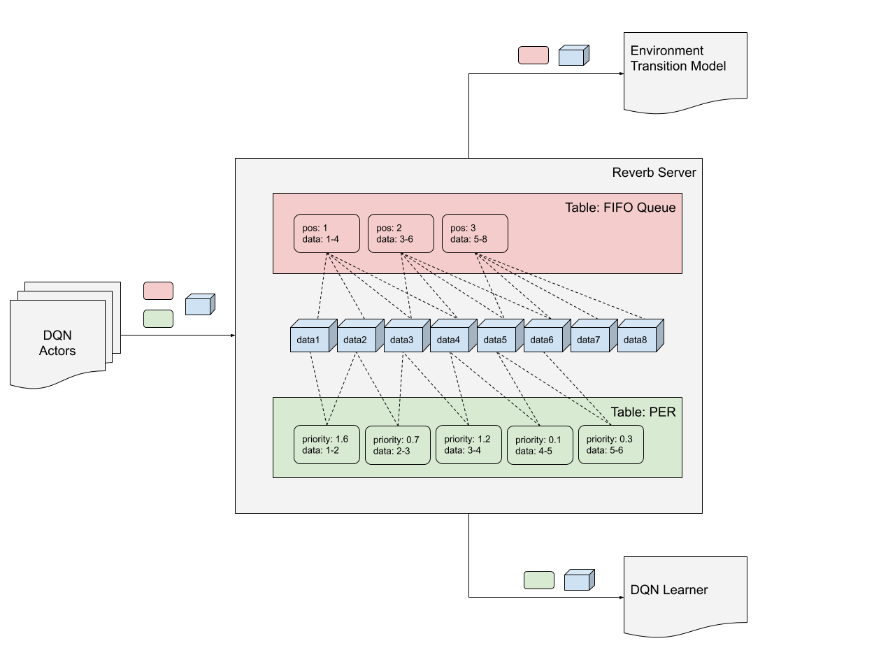

# Reverb

[English](README.md) | [简体中文](https://github.com/google-deepmind/reverb/blob/master/README.zh.md)


[](https://badge.fury.io/py/dm-reverb)

> [!NOTE]
> 本文档为开源社区维护的简体中文翻译。由于上游代码库持续高速迭代，若文档存在更新差异，请以英文原版 [README.md](README.md) 及 [官方文档](https://github.com/google-deepmind/reverb) 为最终权威事实来源（Source of Truth）。

Reverb 是一个专为机器学习研究所设计的高效且易于使用的数据存储与传输系统。Reverb 主要用作分布式强化学习（RL）算法的经验回放（Experience Replay）系统，同时还原生支持多种常用数据结构形态，例如先进先出队列（FIFO）、后进先出栈（LIFO）以及优先队列（Priority Queues）。

## 目录 (Table of Contents)

-   [安装指南](#安装指南-installation)
-   [快速上手](#快速上手-quick-start)
-   [深度架构概览](#深度架构概览-detailed-overview)
    -   [数据表 (Tables)](#数据表-tables)
    -   [条目选取策略 (Item Selection Strategies)](#条目选取策略-item-selection-strategies)
    -   [速率限制器 (Rate Limiting)](#速率限制器-rate-limiting)
    -   [分片与水平扩展 (Sharding)](#分片与水平扩展-sharding)
    -   [检查点机制 (Checkpointing)](#检查点机制-checkpointing)
-   [使用 reverb_server 启动 (Beta)](#使用-reverb_server-启动-beta)
-   [学术引用](#学术引用-citation)

## 安装指南 (Installation)

请注意，Reverb 针对科研探索设计，并非完全面向工业级高可用场景加固；尽管核心功能经过全面测试，但在极端边界情况下仍可能出现异常或底层崩溃。

> [!WARNING]
> Reverb 目前仅支持基于 Linux 的操作系统。

推荐使用 `pip` 安装 Reverb。项目亦提供了基于官方发布所用 Docker 镜像的源码构建指引。

TensorFlow 可以单独安装，亦可在执行 `pip` 时作为依赖一同安装。随 Reverb 一同安装 TensorFlow 可确保底层 C++ ABI 与 Protobuf 版本的最佳兼容性。

```shell
$ pip install dm-reverb[tensorflow]

# 不自动安装 TensorFlow（且不进行版本依赖检查）：
$ pip install dm-reverb
```

### Nightly 每日构建版

[](https://badge.fury.io/py/dm-reverb-nightly)

```shell
$ pip install dm-reverb-nightly[tensorflow]

# 不带 TensorFlow 依赖校验安装：
$ pip install dm-reverb-nightly
```

### 源码编译构建

可参考[源码构建指南](reverb/pip_package/README.md#how-to-develop-and-build-reverb-with-the-docker-containers)获取基于 Docker 容器构建 Reverb 的详细步骤。

### Reverb 版本对应关系 (Reverb Releases)

受限于底层的 `protoc` 与 `absl` 等 C++ 依赖库，各版本的 Reverb 必须与特定版本的 TensorFlow 精准配对。当使用 `pip install dm-reverb[tensorflow]` 时，系统会自动解析并安装对应版本的 TensorFlow。下表列出了 Reverb 各个发行版所对应的 TensorFlow 版本及重要演进节点：

  * `0.13.0`：放弃对 Python 3.8 的支持。
  * `0.11.0`：首个支持 Python 3.11 的版本。
  * `0.10.0`：最后一个支持 Python 3.7 的版本。

| 发行版本 | 分支 / 标签 (Tag) | 对应 TensorFlow 版本 |
| :--- | :--- | :--- |
| **Nightly** | [master](https://github.com/deepmind/reverb) | `tf-nightly` |
| **0.14.0** | [v0.14.0](https://github.com/deepmind/reverb/tree/v0.14.0) | `2.14.0` |
| **0.13.0** | [v0.13.0](https://github.com/deepmind/reverb/tree/v0.13.0) | `2.14.0` |
| **0.12.0** | [v0.12.0](https://github.com/deepmind/reverb/tree/v0.12.0) | `2.13.0` |
| **0.11.0** | [v0.11.0](https://github.com/deepmind/reverb/tree/v0.11.0) | `2.12.0` |
| **0.10.0** | [v0.10.0](https://github.com/deepmind/reverb/tree/v0.10.0) | `2.11.0` |
| **0.9.0** | [v0.9.0](https://github.com/deepmind/reverb/tree/v0.9.0) | `2.10.0` |
| **0.8.0** | [v0.8.0](https://github.com/deepmind/reverb/tree/v0.8.0) | `2.9.0` |
| **0.7.x** | [v0.7.0](https://github.com/deepmind/reverb/tree/v0.7.0) | `2.8.0` |

## 快速上手 (Quick Start)

启动一个 Reverb 服务器非常简单：

```python
import reverb

server = reverb.Server(tables=[
    reverb.Table(
        name='my_table',
        sampler=reverb.selectors.Uniform(),
        remover=reverb.selectors.Fifo(),
        max_size=100,
        rate_limiter=reverb.rate_limiters.MinSize(1)),
    ],
)
```

创建与服务器通信的客户端：

```python
client = reverb.Client(f'localhost:{server.port}')
print(client.server_info())
```

向数据表中写入数据：

```python
# 创建单个条目 (item) 及数据元素 [0, 1]
client.insert([0, 1], priorities={'my_table': 1.0})
```

一个条目亦可同时引用多个底层数据元素：

```python
# 追加三个数据元素，并插入单个引用了全部元素的条目，即 {'a': [2, 3, 4], 'b': [12, 13, 14]}
with client.trajectory_writer(num_keep_alive_refs=3) as writer:
  writer.append({'a': 2, 'b': 12})
  writer.append({'a': 3, 'b': 13})
  writer.append({'a': 4, 'b': 14})

  # 创建引用所有轨迹数据的条目
  writer.create_item(
      table='my_table',
      priority=1.0,
      trajectory={
          'a': writer.history['a'][:],
          'b': writer.history['b'][:],
      })

  # 阻塞直至条目成功插入并获得服务端确认
  writer.flush()
```

已写入 Reverb 的数据可通过采样（Sampling）方式读取：

```python
# client.sample() 返回一个生成器
print(list(client.sample('my_table', num_samples=2)))
```

如需交互式教程，请参考 [Reverb 交互式教程 Notebook](https://github.com/deepmind/reverb/tree/master/examples/demo.ipynb)。

## 深度架构概览 (Detailed Overview)

经验回放已成为训练异策略（Off-policy）强化学习策略的核心基石，被广泛应用于诸如 [Deep Q-Networks (DQN)][DQN]、[Soft Actor-Critic (SAC)][SAC]、[Deep Deterministic Policy Gradients (DDPG)][DDPG] 以及 [Hindsight Experience Replay (HER)][HER] 等前沿算法中。然而，构建一个兼具高吞吐性能、易用性与水平扩展能力的经验回放系统极具技术挑战。

为实现极致性能，Reverb 核心层基于 C++ 构建；为支持跨节点分布式集群部署，系统提供了基于 gRPC 的网络通信服务，用于对数据表执行添加、采样与更新。Python 客户端以简洁优雅的方式封装了全部服务端功能。此外，Reverb 还提供了原生 TensorFlow 算子（Ops），可直接与 TensorFlow 及 `tf.data` 流水线无缝整合。

虽然 Reverb 最初专为异策略强化学习设计，但其通用灵活的架构同样适用于同策略（On-policy）强化学习、乃至有监督与无监督学习场景。甚至有科研团队利用 Reverb 存储并分发频繁更新的模型权重参数，将其作为内存型轻量化分布式文件系统使用（其中每个表映射为一个虚拟文件）。

### 数据表 (Tables)

一个 Reverb `Server` 包含一个或多个数据表（Table）。表用于存储条目（Item），每个条目引用一个或多个底层数据元素（Data Elements）。每个表均需配置采样与移除[选取策略](#条目选取策略-item-selection-strategies)、最大容量限制以及[速率限制器](#速率限制器-rate-limiting)。

**零拷贝跨表引用机制**：不同的条目可以同时引用同一个数据元素，即便这些条目隶属于不同的数据表。这是因为条目仅持有对数据元素的指针/引用，而非深拷贝数据本身。相应地，只有当没有任何条目再持有对某一数据元素的引用时，该数据元素才会被底层物理垃圾回收释放。

例如，可以同时配置一个作为转移数据（长度为 2 的序列）的优先经验回放表（PER），以及另一个作为长度为 3 序列的先进先出队列（FIFO）。此时 PER 表的数据用于训练 DQN 智能体，而 FIFO 队列的数据则用于训练环境转移预测动力学模型。



当满足以下两个条件之一时，条目将自动从表中被移除：

1.  **超出最大容量**：插入新条目导致表中的条目总数超过 `max_size`。此时系统会依据表所配置的**移除策略 (remover)** 决定剔除哪个条目。
2.  **达到最大采样上限**：某个条目的被采样次数超过了速率限制器所允许的 `max_times_sampled` 上限。该条目将被自动销毁删除。

当数据元素不再被任何条目引用时，系统会自动在内存中予以物理释放。

用户对数据的采样与剔除机制拥有全权控制。核心行为由传入 `Table` 的 `sampler` 和 `remover` [选取策略](#条目选取策略-item-selection-strategies) 主导。结合 [`rate_limiter`](#速率限制器-rate-limiting) 与 `max_times_sampled` 参数，可以实现丰富的数据组织范式。常见典型配置包括：

#### 均匀经验回放 (Uniform Experience Replay)

维护最近插入的 `N=1000` 个条目。通过设置 `sampler=reverb.selectors.Uniform()`，所有条目的被选取概率严格均等。配合 `reverb.rate_limiters.MinSize(100)`，采样请求将在插入满 100 个条目之前保持阻塞等待。设置 `remover=reverb.selectors.Fifo()` 使得在容量溢出时优先淘汰最旧的数据：

```python
reverb.Table(
     name='my_uniform_experience_replay_buffer',
     sampler=reverb.selectors.Uniform(),
     remover=reverb.selectors.Fifo(),
     max_size=1000,
     rate_limiter=reverb.rate_limiters.MinSize(100),
)
```

使用均匀经验回放的典型算法包括 [SAC] 与 [DDPG]。

#### 优先经验回放 (Prioritized Experience Replay)

维护容量为 `N=1000` 的条目集合。设置 `sampler=reverb.selectors.Prioritized(priority_exponent=0.8)`，每个条目被采样的概率与其优先级权重成正比：

> 注：具体优先采样算法实现可参阅 [Schaul, Tom, et al.][PER] 的相关文献。

```python
reverb.Table(
     name='my_prioritized_experience_replay_buffer',
     sampler=reverb.selectors.Prioritized(0.8),
     remover=reverb.selectors.Fifo(),
     max_size=1000,
     rate_limiter=reverb.rate_limiters.MinSize(100),
)
```

使用优先经验回放的代表算法包括 DQN（及其各衍生变体）与 [Distributed Distributional Deterministic Policy Gradients (D4PG)][D4PG]。

#### 队列结构 (Queue)

容量上限为 `N=1000` 的数据集合，每次采样与移除操作同时发生（即每个数据出队消费）。若当前集合已有 1000 个条目，插入调用将被阻塞直至腾出空间；若集合为空，采样请求将被阻塞直至有新条目写入：

```python
reverb.Table(
    name='my_queue',
    sampler=reverb.selectors.Fifo(),
    remover=reverb.selectors.Fifo(),
    max_size=1000,
    max_times_sampled=1,
    rate_limiter=reverb.rate_limiters.Queue(size=1000),
)

# 亦可直接使用便捷的工厂方法：
reverb.Table.queue(name='my_queue', max_size=1000)
```

使用队列结构的算法包括 [IMPALA](https://arxiv.org/abs/1802.01561) 与异步实现的 [近端策略优化 (PPO)](https://arxiv.org/abs/1707.06347)。

### 条目选取策略 (Item Selection Strategies)

Reverb 内置了多种可同时用于数据采样（`sampler`）或数据移除（`remover`）的选择器：

-   **Uniform（均匀分布）**：在所有现有条目中均匀随机选取。
-   **Prioritized（优先级分布）**：按条目记录的优先级权重按比例采样。
-   **FIFO（先进先出）**：选取最早插入的最旧数据。
-   **LIFO（后进先出）**：选取最后插入的最新数据。
-   **MinHeap（最小堆）**：选取当前优先级最低的数据。
-   **MaxHeap（最大堆）**：选取当前优先级最高的数据。

上述策略可自由组合至 `Table` 的采样与移除端，赋予开发者根据算法特性定制专属存储策略的高度灵活性。

### 速率限制器 (Rate Limiting)

速率限制器允许对数据表的插入与采样时机施加刚性约束。Reverb 目前原生提供以下速率限制器：

-   **MinSize**：设定表中必须包含的最小条目数门槛，未达到该数量前所有采样请求均处于等待阻塞状态。
-   **SampleToInsertRatio**：通过动态阻塞插入或采样请求，严格控制插入与采样的平均比例。对于精准控制每个样本在被销毁前平均复用（采样）的次数极为有效。
-   **Queue**：保证每个条目在被物理移除前仅被消费采样恰好一次（队列语义）。
-   **Stack**：保证每个条目在被物理移除前仅被消费采样恰好一次（栈语义）。

### 分片与水平扩展 (Sharding)

Reverb 节点之间彼此完全解耦且无状态通信，在扩展为多服务器集群架构时，数据不会在多个节点之间进行跨机冗余复制。这一设计使 Reverb 不适合充当传统强一致性关系数据库，但在容许一定数据丢失的分布式机器学习场景中，极大降低了水平扩展的技术复杂度与网络同步开销。

分布式系统只需简单增加 Reverb 节点的实例数量即可实现水平吞吐翻倍。结合与 gRPC 兼容的负载均衡器（Load Balancer），只需将负载均衡目标地址直接提供给 Reverb Client，即可自动在不同节点间分流并执行并发操作。

在没有专用负载均衡器的极简环境中，系统同样易于扩展：只需启动多个 Reverb Server 并在客户端维护对应的实例连接池即可。

### 检查点机制 (Checkpointing)

Reverb 提供完整的检查点持久化机制，支持将当前 Server 的状态和全量内容写入持久化存储介质。在执行检查点时，`Server` 会序列化重建自身所需的全部数据与元数据。为保障数据一致性，在此期间 `Server` 会临时阻塞所有新到达的插入、采样、更新和删除请求。

通过 Reverb `Client` 触发检查点保存：

```python
# client.checkpoint() 返回检查点写入的物理路径
checkpoint_path = client.checkpoint()
```

从检查点恢复 `reverb.Server`：

```python
# Checkpointer 接收保存检查点的根目录路径。
# 传入上述检查点所在根目录，新服务器将自动加载旧服务器写入的最新检查点。
checkpointer = reverb.platform.checkpointers_lib.DefaultCheckpointer(
  path=checkpoint_path.rsplit('/', 1)[0])

# 传递给 tables= 的参数结构必须与写入该检查点的原始 Server 完全一致。
server = reverb.Server(tables=[...], checkpointer=checkpointer)
```

关于 Reverb 检查点底层序列化机制的更多技术细节，请参阅 [tfrecord_checkpointer.h](https://github.com/deepmind/reverb/tree/master/reverb/cc/platform/tfrecord_checkpointer.h)。

## 使用 reverb_server 启动 (Beta)

通过 `pip` 安装 `dm-reverb` 后，系统会自动注册 `reverb_server` 可执行脚本。该脚本支持通过 TextProto 格式的配置文本直接启动服务。例如：

```bash
$ reverb_server --config="
port: 8000
tables: {
  table_name: \"my_table\"
  sampler: {
    fifo: true
  }
  remover: {
    fifo: true
  }
  max_size: 200 max_times_sampled: 5
  rate_limiter: {
    min_size_to_sample: 1
    samples_per_insert: 1
    min_diff: $(python3 -c "import sys; print(-sys.float_info.max)")
    max_diff: $(python3 -c "import sys; print(sys.float_info.max)")
  }
}"
```

上述 `rate_limiter` 的 TextProto 配置完全等价于 Python 表达式 `MinSize(1)`，具体映射机制请参见 `rate_limiters.py`。

## 学术引用 (Citation)

若在学术研究或工程实践中使用了 Reverb，请引用 [Reverb 论文](https://arxiv.org/abs/2102.04736)：

```bibtex
@misc{cassirer2021reverb,
      title={Reverb: A Framework For Experience Replay},
      author={Albin Cassirer and Gabriel Barth-Maron and Eugene Brevdo and Sabela Ramos and Toby Boyd and Thibault Sottiaux and Manuel Kroiss},
      year={2021},
      eprint={2102.04736},
      archivePrefix={arXiv},
      primaryClass={cs.LG}
}
```

<!-- 核心论文链接 -->

[D4PG]: https://arxiv.org/abs/1804.08617
[DDPG]: https://arxiv.org/abs/1509.02971
[DQN]: https://www.nature.com/articles/nature14236
[HER]: https://arxiv.org/abs/1707.01495
[PER]: https://arxiv.org/abs/1511.05952
[SAC]: https://arxiv.org/abs/1801.01290
